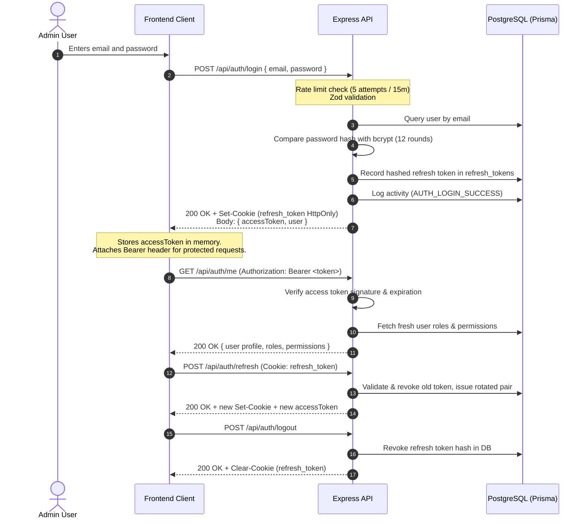

# Explore Dhandusar — Authentication Architecture

## 1. Overview & Strategy

The private administrative system of **Explore Dhandusar** uses a hybrid stateless/stateful token architecture designed for high security and seamless user experience:

- **Access Token**: Short-lived (15 minutes) JSON Web Token (JWT) transmitted via the `Authorization: Bearer <token>` header (or optional fallback cookie). Contains safe identity claims (`userId`, `email`, `roles`).
- **Refresh Token**: Long-lived (7 days) cryptographically random JWT delivered exclusively via a strict **`HttpOnly`, `SameSite: Lax/Strict`, `Secure`** cookie.
- **Revocation & Rotation**:
  - Raw refresh tokens are never stored in plain text. A **SHA-256 hash** of each token is recorded in PostgreSQL (`refresh_tokens` table).
  - On every token refresh (`POST /api/auth/refresh`), the old token is invalidated and a newly rotated token pair is issued (token rotation prevents replay attacks).
  - On logout (`POST /api/auth/logout`), the refresh token is immediately revoked in the database.
  - On password change (`POST /api/auth/change-password`), **all active refresh tokens** for that user are revoked across all devices.

---

## 2. Authentication Flow



---

## 3. Password Security Policies

- **Hashing Algorithm**: `bcryptjs` with **12 salt rounds**.
- **Complexity Rules**:
  - Minimum 8 characters.
  - At least one uppercase letter (`[A-Z]`).
  - At least one lowercase letter (`[a-z]`).
  - At least one digit or symbol (`[0-9!@#$%^&*...]`).
- **Protection Against Account Enumeration**:
  - Login failure always returns generic message: `"Invalid email or password"` (`INVALID_CREDENTIALS`).
  - Response timing is kept consistent.
- **Audit Logging**: All failed attempts, successful logins, logouts, and password modifications are automatically recorded in the `activity_logs` table with client IP and user agent.

---

## 4. Rate Limiting

- An in-memory sliding-window rate limiter protects `POST /api/auth/login`.
- Maximum **5 failed attempts per IP address** within a 15-minute window.
- Exceeding the threshold triggers HTTP `429 Too Many Requests`.
- The counter is cleared automatically upon successful authentication.

---

## 5. API Endpoints

### 1. `POST /api/auth/login`
- **Access**: Public (Protected by rate limiter)
- **Body**:
  ```json
  {
    "email": "admin@dhandusar.gujarat.gov.in",
    "password": "StrongPassword123!"
  }
  ```
- **Response (200 OK)**:
  ```json
  {
    "success": true,
    "message": "Login successful",
    "data": {
      "accessToken": "eyJhbGciOiJIUzI1NiIs...",
      "user": {
        "id": "uuid-here",
        "email": "admin@dhandusar.gujarat.gov.in",
        "name": "Chief Administrator",
        "avatarUrl": null,
        "isActive": true,
        "roles": ["SUPER_ADMIN"],
        "permissions": ["dashboard.view", "news.create", "..."]
      }
    },
    "meta": { "timestamp": "2026-11-06T00:00:00.000Z" }
  }
  ```
- **Cookie**: `refresh_token` (`HttpOnly`, `Path=/api/auth`, `SameSite=Lax/Strict`, `Max-Age=7d`).

### 2. `POST /api/auth/refresh`
- **Access**: Public (Requires valid `refresh_token` in HttpOnly cookie or request body)
- **Response (200 OK)**:
  ```json
  {
    "success": true,
    "message": "Token refreshed successfully",
    "data": {
      "accessToken": "eyJhbGciOiJIUzI1NiIs..."
    }
  }
  ```

### 3. `POST /api/auth/logout`
- **Access**: Public / Authenticated
- **Behavior**: Invalidates the active refresh token in PostgreSQL and clears the client cookie.

### 4. `GET /api/auth/me`
- **Access**: Private (Requires `Authorization: Bearer <accessToken>`)
- **Response (200 OK)**: Returns sanitized profile, active roles, and permission list.

### 5. `POST /api/auth/change-password`
- **Access**: Private (Requires `Authorization: Bearer <accessToken>`)
- **Body**:
  ```json
  {
    "currentPassword": "OldPassword123!",
    "newPassword": "NewStrongPassword456@"
  }
  ```
- **Behavior**: Verifies current password, updates hash, and revokes all active sessions across devices.

---

## 6. Security Limitations & Production Checklist

1. **Production Secrets**: Generate cryptographically strong secrets (`openssl rand -hex 32`) for `JWT_ACCESS_SECRET` and `JWT_REFRESH_SECRET`. Never use development defaults in production.
2. **Reverse Proxy (HTTPS)**: In production (e.g. behind Nginx, Cloudflare, or AWS ALB), ensure `trust proxy` is configured on Express so that client IP detection for rate limiting and audit logging is accurate.
3. **Distributed Rate Limiting**: The in-memory rate limiter is single-node. For multi-instance horizontal scaling, replace the in-memory map with a Redis-backed store (e.g. `rate-limit-redis`).

