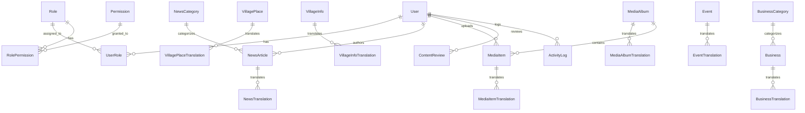

# Explore Dhandusar — Database Architecture & Data Dictionary

## 1. Overview & Principles

Explore Dhandusar utilizes **PostgreSQL** managed through **Prisma ORM**. The schema is engineered to support a rich, bilingual digital platform for Dhandusar, Gujarat, encompassing:
- Role-Based Access Control (RBAC) and Publishing Approval Workflows
- First-class bilingual support (Gujarati `GU` + English `EN`)
- News, Announcements, and Alerts
- Village Landmarks, Temples, and Historical Sites
- Community Heritage, Agriculture, Dairy, and Traditions
- Local Business Directory
- Events and Cultural Celebrations
- Media Asset Management backed by Cloudinary
- Full Audit and Review Logs

---

## 2. Entity-Relationship Overview



---

## 3. Bilingual Translation Architecture

To guarantee clean data separation, non-translatable metadata is isolated from localized copy:

| Layer | Responsibility | Examples |
|---|---|---|
| **Base Model** | IDs, relations, timestamps, coordinates, phone numbers, workflow status, Cloudinary IDs | `id`, `categoryId`, `status`, `latitude`, `longitude`, `publishedAt` |
| **Translation Model** | Localized strings, human-readable slugs, rich text content, SEO tags | `languageCode`, `title`, `slug`, `summary`, `content`, `seoTitle` |

### Key Invariants:
1. **Language Scope**: `LanguageCode` enum strictly supports `GU` (Gujarati) and `EN` (English).
2. **Translation Uniqueness**:
   - `@@unique([parentId, languageCode])` prevents multiple translations of the same language on a single entity.
   - `@@unique([languageCode, slug])` ensures URLs (e.g. `/gu/news/samachar-1` vs `/en/news/news-1`) are unique within each language namespace.
3. **Cascading Deletions**: Deleting a parent base entity automatically cascades and cleans up all related translation records.

---

## 4. Enumerations

### `LanguageCode`
- `GU`: Gujarati
- `EN`: English

### `ContentStatus`
Tracks the administrative publishing lifecycle:
- `DRAFT`: Work in progress by an Editor.
- `PENDING_REVIEW`: Submitted by an Editor awaiting Publisher review.
- `CHANGES_REQUESTED`: Sent back to Editor with feedback.
- `PUBLISHED`: Approved and live on the public website.
- `ARCHIVED`: Deprecated or historical content.
- `REJECTED`: Declined by a Publisher.

### `PlaceType`
- `TEMPLE`: Religious and spiritual places (mandirs, ashrams).
- `HISTORICAL_SITE`: Heritage buildings, stepwells, historical memorials.
- `LANDMARK`: Prominent village gates, lakes, chowks.
- `PUBLIC_FACILITY`: Panchayat office, community hall, primary health center, school.

### `VillageInfoCategory`
- `AGRICULTURE`: Crop profiles, soil information, seasonal cycles.
- `FARMING`: Modern farming practices, irrigation, organic initiatives.
- `DAIRY`: Milk cooperative societies, livestock centers.
- `ANIMAL_HUSBANDRY`: Veterinary care, cattle conservation.
- `CULTURE`: Folk arts, traditional attire, dialect, festivals.
- `TRADITION`: Village fairs, folklore, community rituals.

### `MediaType`
- `IMAGE`: Photographs and infographics.
- `VIDEO`: Video clips and village documentaries.
- `DOCUMENT`: PDFs and official village notices.

---

## 5. Data Dictionary

### Admin & RBAC
- **`users`**: System users (admins, editors, publishers). Stores bcrypt `passwordHash`, `email`, `name`, `avatarUrl`, and `isActive` flag.
- **`roles`**: System roles (`SUPER_ADMIN`, `ADMIN`, `EDITOR`, `PUBLISHER`).
- **`permissions`**: Fine-grained capability codes (`news:create`, `news:publish`, etc.).
- **`user_roles`**: Join table mapping users to roles.
- **`role_permissions`**: Join table mapping roles to permissions.

### News & Announcements
- **`news_categories`**: News taxonomy with bilingual labels (`nameGu`, `nameEn`, `slug`).
- **`news_articles`**: Master article table (`categoryId`, `authorId`, `status`, `isPinned`, `publishedAt`, `expiresAt`, `sourceUrl`, `sourceName`).
- **`news_translations`**: Localized article title, slug, summary, markdown content, and SEO attributes.

### Village Places
- **`village_places`**: Physical village entities (`type`, `status`, `latitude`, `longitude`, `address`, `contactPhone`, `featuredImage`, `isFeatured`).
- **`village_place_translations`**: Localized names, history, architectural notes, and visiting/darshan timings.

### Village Information
- **`village_info`**: Thematic village heritage and civic profile records (`category`, `status`, `featuredImage`, `sortOrder`, `isFeatured`).
- **`village_info_translations`**: Localized content, summaries, and SEO metadata.

### Businesses & Services
- **`business_categories`**: Commercial taxonomy (`nameGu`, `nameEn`, `slug`, `icon`).
- **`businesses`**: Commercial records (`categoryId`, `phone`, `email`, `website`, `address`, `openingHours`, `isVerified`, `status`).
- **`business_translations`**: Localized business name, slug, owner name, products/services description.

### Events & Celebrations
- **`events`**: Scheduled occasions (`startDate`, `endDate`, `location`, `status`, `isFeatured`).
- **`event_translations`**: Localized event title, slug, description, organizer, and venue notes.

### Gallery & Media (Cloudinary)
- **`media_albums`**: Collections of multimedia assets.
- **`media_album_translations`**: Localized album title, description, and slug.
- **`media_items`**: Cloudinary asset reference (`publicId`, `secureUrl`, `format`, `resourceType`, `width`, `height`, `bytes`, `uploadedById`).
- **`media_item_translations`**: Localized captions, alt text, and photo credits.

### Publishing Approval & Activity Auditing
- **`content_reviews`**: Review trail linking reviewers to content (`entityType`, `entityId`, `fromStatus`, `toStatus`, `feedback`).
- **`activity_logs`**: System audit trail capturing user ID, IP address, user agent, action string, and contextual JSON metadata.

---

## 6. Repository (Data Access) Layer

All direct Prisma queries are strictly encapsulated in `backend/src/repositories/`:

```
Controller / Service
       │
       ▼
 [ Repository ]  ◄── Enforces pagination, includes, filters & translations
       │
       ▼
 [ PrismaClient ]
       │
       ▼
 [ PostgreSQL ]
```

### Concrete Examples:
- **`UserRepository`**: Encapsulates user retrieval, role assignment, and pagination.
- **`NewsRepository`**: Demonstrates the bilingual retrieval pattern:
  - `findPublished(language)`: Filters published and unexpired articles, loading only the translation for the specified language.
  - `findBySlug(slug, language)`: Looks up articles by localized URL slug.
  - `createWithTranslation()`: Executes atomic transaction to create both base entity and localized copy simultaneously.

---

## 7. PostgreSQL Connection Management

To support cloud providers (such as Supabase or Neon) with connection poolers (PgBouncer):

```
backend/
├── .env
│   ├── DATABASE_URL   # Transaction-mode pooled connection (port 6543)
│   └── DIRECT_URL     # Session-mode direct connection (port 5432)
```

1. **`DATABASE_URL`**: Used by the Express application at runtime for high-throughput, low-latency pooled queries.
2. **`DIRECT_URL`**: Configured as Prisma's `directUrl` for migrations, schema changes, and introspection without session lock conflicts.

---

## 8. Migration Commands

```bash
# Check current migration status against database
npm run --workspace=backend prisma:status  # or: npx prisma migrate status

# Apply pending migrations to the configured database
npx prisma migrate deploy

# Generate Prisma Client after schema changes
npm run --workspace=backend prisma:generate
```

