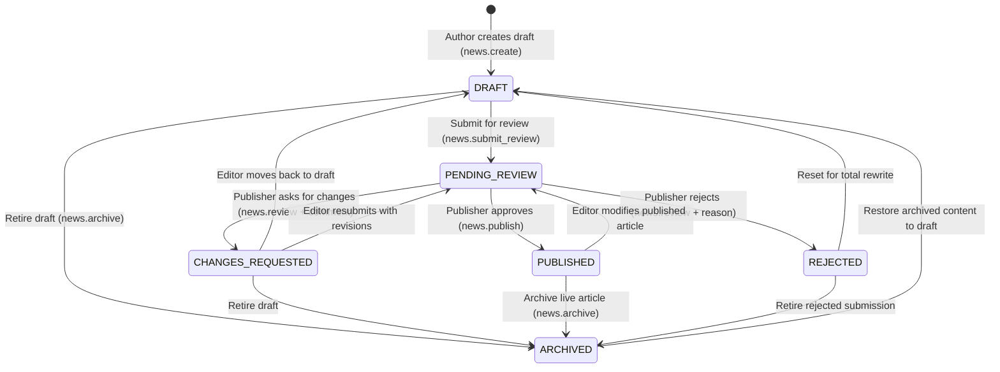

# Explore Dhandusar — Publishing Workflow Engine

## 1. Overview

Explore Dhandusar uses a strict, role-governed publishing workflow to maintain the integrity of public information for the village portal. The publishing workflow engine ensures that:
- Content authored by **Content Editors** cannot go live without formal review.
- Content must pass validation checks (bilingual completeness, required fields, unique localized slugs).
- Reviewers (**Publishers** and **Super Admins**) can approve, request changes, or reject submissions.
- An append-only audit trail (`ContentReview` and `ActivityLog`) records every action and state transition.
- **Public endpoints strictly isolate published, non-expired content**, preventing access to drafts, rejected, changes-requested, or archived articles.

---

## 2. Workflow State Machine

The workflow enforces finite state transitions between the six approved content states:



### Transition Matrix

| From State | Allowed Target States | Required Permission | Additional Validation |
| :--- | :--- | :--- | :--- |
| `DRAFT` | `PENDING_REVIEW` | `news.submit_review` | Category assigned, ≥1 translation with valid title (≥3 chars), slug (≥2 chars), content (≥10 chars) |
| `DRAFT` | `ARCHIVED` | `news.archive` | Discards draft without deletion |
| `PENDING_REVIEW` | `PUBLISHED` | `news.publish` | Sets `publishedAt = now()`, records approval note |
| `PENDING_REVIEW` | `CHANGES_REQUESTED` | `news.review` | **Mandatory review feedback** (minimum 5 characters) |
| `PENDING_REVIEW` | `REJECTED` | `news.review` | **Mandatory rejection reason** (minimum 5 characters) |
| `CHANGES_REQUESTED`| `PENDING_REVIEW` | `news.submit_review` | Resubmission after editorial fixes |
| `CHANGES_REQUESTED`| `DRAFT` | `news.edit` | Moves back to private draft workspace |
| `CHANGES_REQUESTED`| `ARCHIVED` | `news.archive` | Retires requested draft |
| `PUBLISHED` | `ARCHIVED` | `news.archive` | Removes article from public site immediately |
| `PUBLISHED` | `PENDING_REVIEW` | `news.edit` | Policy trigger: Content Editor edits published article |
| `REJECTED` | `DRAFT` | `news.edit` | Reopens rejected submission for rewriting |
| `ARCHIVED` | `DRAFT` | `news.edit` | Restores archived content to working draft |

---

## 3. Policy on Editing Published Content

To prevent accidental modification or unauthorized tampering with live public content:
1. **Content Editors (without `news.publish` permission):**
   - Editing a `PUBLISHED` article automatically moves the article back into `PENDING_REVIEW`.
   - The editor's revisions are not live until a Publisher or Super Admin reviews and publishes them.
   - An `ActivityLog` entry (`NEWS_EDIT_REVERTED_TO_REVIEW`) and `ContentReview` entry are created.
2. **Publishers / Super Admins (with `news.publish` permission):**
   - Allowed to update live articles in-place (e.g. correcting minor typos or updating source links) while preserving `PUBLISHED` status.
   - Every update generates an immutable `ActivityLog` entry (`NEWS_UPDATED`) documenting the modified fields.

---

## 4. Bilingual Translation Engine

The village platform operates bilingually in **Gujarati (`GU`)** and **English (`EN`)**:

- **Independent Translation Records:** Articles have a base record (`NewsArticle`) linked to one or more `NewsTranslation` records.
- **Single Translation Allowed Initially:** Articles can be drafted in Gujarati first, with English added later (or vice-versa).
- **Language-Scoped Slugs:** Unique constraint `@@unique([languageCode, slug])` ensures Gujarati and English slugs never conflict.
- **No Automatic Pseudo-Translation:** If an article has not been translated into English, it is not exposed on English public queries.
- **Public Isolation:** Public queries request a specific language (`?lang=GU` or `?lang=EN`). An article is only returned if it possesses a translation in that language.

---

## 5. Audit Trail & Content Review Tracking

Every workflow transition generates two database audit records in an atomic transaction:

1. **`ContentReview` (Editorial Review History):**
   - Records `entityType` (`NewsArticle`), `entityId`, `reviewerId`, `fromStatus`, `toStatus`, and `feedback`.
   - Accessible via `GET /api/news/admin/:id`.
   - Append-only; cannot be altered or deleted via standard APIs.
2. **`ActivityLog` (Security Audit Trail):**
   - Records `userId`, `action` (e.g. `NEWS_DRAFT_CREATED`, `NEWS_SUBMITTED_FOR_REVIEW`, `NEWS_CHANGES_REQUESTED`, `NEWS_PUBLISHED`), `metadata`, `ipAddress`, `userAgent`, and `createdAt`.

---

## 6. Reusability for Future Modules

The workflow engine in `src/services/publishingWorkflow.service.ts` is modular and entity-agnostic:
```typescript
await publishingWorkflowService.recordStatusChange(tx, {
  entityType: 'VillagePlace', // Reusable for Temples, Businesses, Events, Gallery Albums
  entityId: placeId,
  reviewerId: userId,
  currentStatus: place.status,
  targetStatus: ContentStatus.PUBLISHED,
  feedback: 'Temple history verified with Gram Panchayat records.',
});
```
Future phases (Places, Village Info, Businesses, Events, Media Albums) will reuse this exact service without refactoring.

